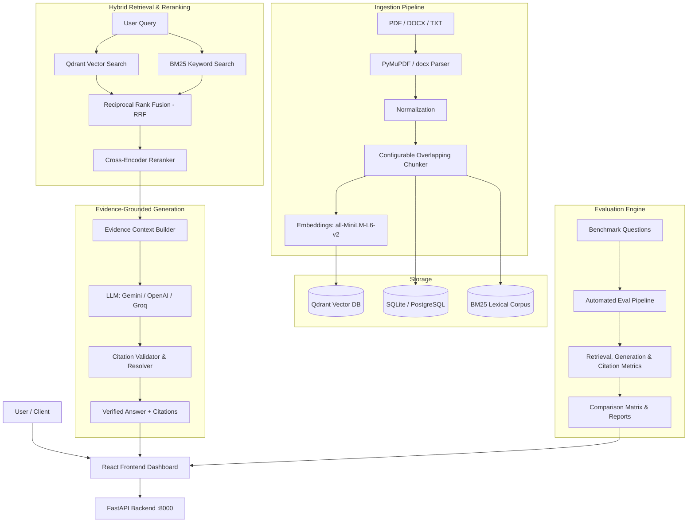

# RAG with Citations + Evals
> **Citation-Grounded Retrieval-Augmented Generation with Automated Quality & Faithfulness Evaluation**

[](https://fastapi.tiangolo.com)
[](https://react.dev)
[](https://qdrant.tech)
[](https://tailwindcss.com)
[](https://pytest.org)

---

## 📌 Executive Summary
Most traditional Retrieval-Augmented Generation (RAG) applications simply retrieve passages and feed them to an LLM. While they often produce fluent answers, they fail on two critical fronts:
1. **Unverifiable Claims & Hallucinations:** Traditional chatbots fail to explain or prove where specific facts originated.
2. **Lack of Performance Measurement:** Teams deploy RAG architectures without quantifiable metrics on retrieval effectiveness or citation validity.

**RAG with Citations + Evals** is a complete, production-grade RAG platform built to solve these issues:
- **Citation Grounding:** Every factual claim is coupled with verifiable source citations (`[S1]`, `[S2]`) mapping directly to document names, page numbers, and exact supporting snippets. Unsupported queries return explicit insufficient-evidence notices.
- **Automated Dual-Stage Evaluation:** Measures both **Retrieval Quality** (Precision@K, Recall@K, MRR, NDCG@K) and **Generation Accuracy** (Faithfulness, Relevancy, Citation Precision/Recall/Coverage/Validity) with side-by-side experiment benchmarking.

---

## 🏛 System Architecture



---

## 🚀 Key Features

- **Multi-Format Document Ingestion:** PyMuPDF (PDF page-by-page), `python-docx` (DOCX), and plain text with whitespace normalization and SHA-256 deduplication.
- **Hybrid Retrieval + RRF:** Combines dense semantic vectors with lexical BM25 keyword matching fused via Reciprocal Rank Fusion ($k=60$).
- **Cross-Encoder Reranking:** Deep cross-attention reranking (`cross-encoder/ms-marco-MiniLM-L-6-v2`) on top retrieved candidates.
- **Strict Citation Validation:** Resolves source identifiers to indexed chunks, verifies quote authenticity against passage text, and flags hallucinations.
- **Comprehensive Evaluation Engine:**
  - **Retrieval:** Precision@K, Recall@K, Mean Reciprocal Rank (MRR), NDCG@K, Hit Rate@K.
  - **Generation:** Faithfulness, Answer Relevancy, Context Recall, Token-level F1 Answer Correctness.
  - **Citations:** Citation Precision, Recall, Coverage, and Validity.
- **Interactive UI & Inspection Drawer:** React + TypeScript + Tailwind frontend with clickable citation tags, highlighted source quotes, and experiment comparison dashboard.

---

## 👥 How to Use This Project

### 🧑‍💻 For Individuals (Developers, Researchers & Students)
- **Local Private Knowledge Base:** Chat with personal research papers, PDF textbooks, legal agreements, or technical manuals on your local machine with full confidence in citations.
- **RAG Engineering Portfolio & Learning:** Use this project as a benchmark reference for modern production RAG engineering beyond naive prototypes (e.g. hybrid search, rerankers, citation resolvers).
- **Offline / Cost-Free Experimentation:** Supports local in-memory/disk vector search (Qdrant embedded mode), SQLite database, and offline deterministic fallback generation without requiring paid API keys or cloud infrastructure.

### 🏢 For Organizations (Enterprises, Teams & Compliance)
- **Enterprise Document Intelligence:** Deploy in legal, healthcare, engineering, or financial compliance where hallucinated answers pose severe risks and every claim requires auditability back to specific document pages.
- **Model & Configuration Benchmarking (A/B Testing):** Evaluate chunk sizes (300 vs 500 vs 800 tokens), overlap ratios, embedding models, and LLMs against a standardized company ground-truth dataset to optimize accuracy vs latency vs cost.
- **Internal Compliance & Support Chatbots:** Power employee policy assistants or customer-facing documentation search with guaranteed source attribution, avoiding false claims and legal liabilities.
- **Microservice Integration:** Production-ready Docker containerization (`docker-compose.yml`) with PostgreSQL, Qdrant, FastAPI backend, and React frontend ready for cloud deployment (AWS, GCP, Azure, Railway, Render).

---

## ⚡ Quick Start Guide

### Prerequisites
- Python 3.10+
- Node.js 18+ (with npm)

### 1. Backend Setup (Virtual Environment)
```bash
# Clone the repository
git clone https://github.com/Vedang-tiwari/RAG-with-Citation-Evals.git
cd RAG-with-Citation-Evals

# Activate virtual environment
# Windows PowerShell:
.\venv\Scripts\Activate.ps1
# Linux / macOS:
source venv/bin/activate

# Install requirements (if setting up fresh)
pip install -r backend/requirements.txt

# Start FastAPI backend
python -m uvicorn backend.app.main:app --reload --port 8000
```
- **API Documentation (Swagger UI):** `http://localhost:8000/docs`
- **Health Check:** `http://localhost:8000/health`

### 2. Frontend Setup
```bash
cd frontend
npm install
npm run dev
```
- **Frontend Dashboard:** `http://localhost:3000`

### 3. Docker Deployment (Optional)
```bash
docker-compose up --build
```
Spins up PostgreSQL, Qdrant, FastAPI backend, and React frontend.

---

## 🧪 Testing & Evaluation CLI

### Run Full Test Suite
```bash
# Run all 16 unit and integration tests
.\venv\Scripts\python.exe -m pytest backend/tests -v
```

### CLI Automation Scripts
```bash
# 1. Ingest documents from a directory
.\venv\Scripts\python.exe scripts/ingest_documents.py --path data/sample_documents --chunk-size 500

# 2. Run automated benchmark evaluation
.\venv\Scripts\python.exe scripts/run_evaluation.py --name "Hybrid-Rerank-Benchmark" --strategy hybrid --top-k 5

# 3. Compare historical experiments side-by-side
.\venv\Scripts\python.exe scripts/compare_experiments.py
```

---

## 📊 Evaluation Metrics Reference

| Category | Metric | Definition |
|---|---|---|
| **Retrieval** | `Precision@K` | Ratio of relevant chunks retrieved in top-$K$ |
| | `Recall@K` | Proportion of total ground-truth passages retrieved |
| | `MRR` | Mean Reciprocal Rank of the first relevant result |
| | `NDCG@K` | Graded ranking quality discounted by position |
| | `Hit Rate@K` | Whether at least one ground-truth passage was retrieved |
| **Generation** | `Faithfulness` | Ratio of answer claims strictly inferred from evidence |
| | `Answer Relevancy` | Directness and relevance of answer to the user query |
| | `Answer Correctness`| F1 token similarity against ground-truth answer |
| | `Context Recall` | Proportion of ground truth facts present in retrieved chunks |
| **Citations** | `Citation Precision` | Percentage of cited references verifying the exact claims |
| | `Citation Recall` | Proportion of required evidence supported by citations |
| | `Citation Coverage` | Percentage of factual statements bearing inline citations |
| | `Citation Validity` | Percentage of source tags (`[S#]`) resolving to valid records |

---

## 🛠 Tech Stack

- **Backend:** FastAPI, Python 3.12, Uvicorn, Pydantic V2
- **Vector Database:** Qdrant (supports local embedded storage and cloud)
- **Relational Storage:** SQLite (local out-of-the-box) / PostgreSQL (production)
- **Search & Ranking:** Rank-BM25, Reciprocal Rank Fusion (RRF), Cross-Encoder Reranker
- **Document Parsers:** PyMuPDF (fitz), python-docx
- **LLM Integrations:** Google Gemini, OpenAI, Groq, and offline heuristic mock engine
- **Frontend:** React 18, TypeScript, Vite, Tailwind CSS, Lucide Icons
- **Testing:** Pytest, Pytest-AsyncIO, HTTPX

---

## 📁 Repository Structure

```text
rag-citations-evals/
├── backend/
│   ├── app/
│   │   ├── main.py                # FastAPI app & lifespan configuration
│   │   ├── api/                   # REST routes (documents, chat, evaluation, experiments)
│   │   ├── core/                  # Settings, logging, and security
│   │   ├── database/              # SQLAlchemy models, sessions, and repository
│   │   ├── ingestion/             # PDF/DOCX/TXT parser, cleaner, chunker, and pipeline
│   │   ├── embeddings/            # Text embedder with fallback vectorizer
│   │   ├── retrieval/             # Qdrant search, BM25, RRF fusion, and Cross-Encoder
│   │   ├── generation/            # Evidence prompts, LLM client, and RAG pipeline
│   │   ├── citations/             # Citation resolver, validator, and metrics
│   │   ├── evaluation/            # Retrieval, generation, and citation evaluators
│   │   └── schemas/               # Pydantic request and response schemas
│   ├── tests/                     # Unit and integration tests (16 tests)
│   ├── requirements.txt
│   └── Dockerfile
├── frontend/
│   ├── src/
│   │   ├── components/            # ChatInterface, DocumentManager, CitationInspector, EvalDashboard
│   │   ├── services/api.ts        # Typed API client
│   │   └── types/                 # Shared TypeScript interfaces
│   ├── package.json
│   └── Dockerfile
├── data/sample_documents/         # Sample documentation for instant testing
├── evaluation/datasets/           # Ground-truth evaluation benchmarks
├── scripts/                       # CLI ingestion, eval runner, and comparison
└── docker-compose.yml
```

---

## 📜 License
MIT License. Open-source for research, development, and enterprise applications.
