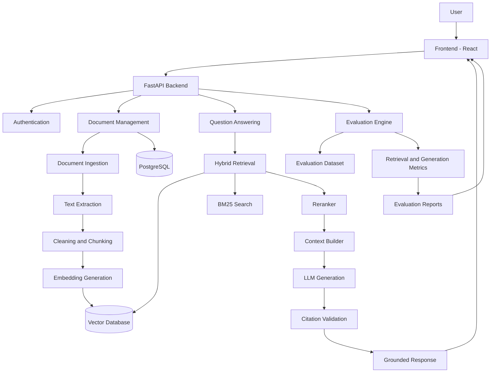
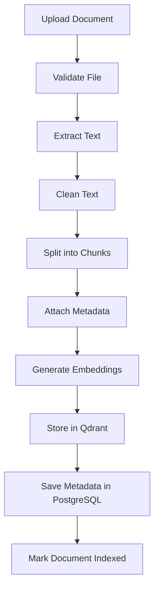
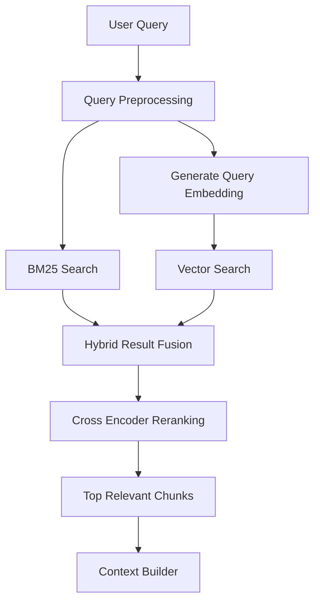
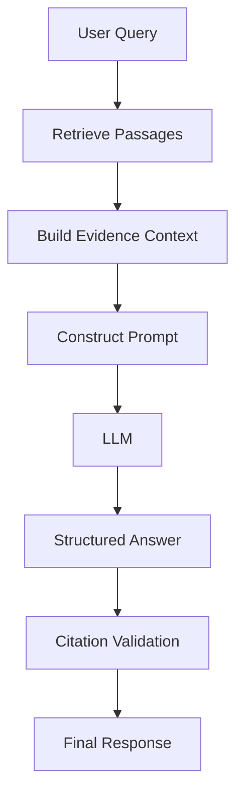
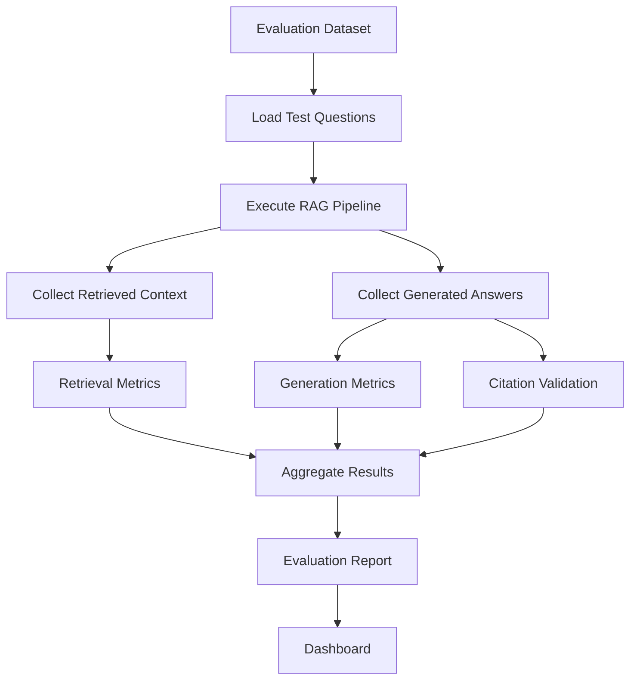

# RAG with Citations + Evals
### A Citation-Grounded Retrieval-Augmented Generation System with Automated Evaluation

---

## Quick Start & Running Guide

All Python packages are installed in the local virtual environment (`./venv`).

### 1. Start the Backend API (FastAPI)
```bash
# Windows PowerShell
.\venv\Scripts\python.exe -m uvicorn backend.app.main:app --reload --port 8000
```
- API Docs: `http://localhost:8000/docs`
- Health check: `http://localhost:8000/health`

### 2. Start the Frontend Dashboard (React + Vite + Tailwind)
```bash
cd frontend
npm run dev
```
- Frontend Web App: `http://localhost:3000`

### 3. Run Automated Tests
```bash
.\venv\Scripts\python.exe -m pytest backend/tests -v
```

### 4. CLI Scripts
```bash
# Ingest documents from folder
.\venv\Scripts\python.exe scripts/ingest_documents.py --path data/sample_documents

# Execute automated evaluation experiment
.\venv\Scripts\python.exe scripts/run_evaluation.py --name "Benchmark Test" --strategy hybrid --top-k 5

# Compare experiments and output comparison matrix
.\venv\Scripts\python.exe scripts/compare_experiments.py
```

---

## 1. Project Overview

**RAG with Citations + Evals** is a Retrieval-Augmented Generation (RAG) application designed to answer questions from a custom knowledge base while providing verifiable citations for generated responses.

Unlike traditional RAG applications that simply retrieve documents and pass them to an LLM, this project focuses on two critical aspects of reliable AI systems:

- **Citation Grounding:** Every factual answer should be supported by relevant source passages, with references to the original documents and page numbers.
- **Automated Evaluation:** Retrieval quality, answer correctness, faithfulness, and citation accuracy should be measured using an evaluation pipeline.

Users can upload documents, ask questions, inspect the retrieved passages, verify citations, and evaluate system performance through an evaluation dashboard.

The system is designed to demonstrate how a practical RAG application can be developed, tested, evaluated, and improved.

---

## 2. Problem Statement

Organizations frequently store important information across PDFs, technical documentation, research papers, reports, manuals, and internal knowledge bases.

Finding specific information in these documents creates several problems:

1. **Information Overload:** Users must manually search through large collections of documents.
2. **Hallucinations:** LLMs can generate answers that sound convincing but are not supported by the provided documents.
3. **Lack of Transparency:** Traditional chatbot responses often fail to explain where their information originated.
4. **Poor Retrieval Quality:** Relevant information may not be retrieved because of ineffective chunking, embeddings, or search strategies.
5. **No Quality Measurement:** Developers often evaluate RAG systems manually without understanding their actual retrieval and generation performance.
6. **Inconsistent Responses:** The same question may produce different answers depending on retrieval quality and generation behavior.

### Core Problem

How can we build a RAG application that not only generates answers from documents but also proves where those answers came from and measures how reliably the system performs?

---

## 3. Proposed Solution

Develop a citation-grounded RAG platform with an integrated evaluation framework.

The application will:

- Accept PDF, DOCX, and TXT documents.
- Extract and preprocess document content.
- Divide documents into meaningful chunks.
- Generate embeddings and store them in a vector database.
- Retrieve relevant passages using semantic and keyword search.
- Rerank retrieved passages to improve relevance.
- Generate answers using an LLM.
- Attach source citations to generated answers.
- Allow users to inspect the exact supporting passages.
- Evaluate retrieval and generation quality using automated metrics.
- Generate evaluation reports to compare different RAG configurations.

### Expected Output

For every user question, the application should return:

1. A natural-language answer.
2. Source document references.
3. Page numbers or section references where available.
4. Exact supporting text snippets.
5. Confidence or evidence indicators.
6. A list of retrieved passages.
7. Evaluation results when running an evaluation experiment.

---

## 4. Key Features

### A. Document Management

- Upload PDF, DOCX, and TXT files.
- Extract document text and metadata.
- Document-level processing status.
- Duplicate document detection using file hashes.
- Document deletion and re-indexing.
- Track document versions.

### B. Intelligent Document Processing

- Text extraction.
- Text cleaning and normalization.
- Configurable chunk sizes.
- Overlapping chunks.
- Metadata preservation.
- Page number tracking.
- Document and chunk identification.

### C. Hybrid Retrieval

Implement multiple retrieval strategies:

- Dense vector search.
- BM25 keyword search.
- Hybrid search.
- Metadata filtering.
- Top-K retrieval.
- Configurable retrieval parameters.

Hybrid search combines semantic similarity with keyword matching, helping retrieve both conceptually related passages and exact technical terms.

### D. Reranking

Use a cross-encoder reranker to reorder retrieved passages based on their relevance to the user's query.

Example:

Initial retrieval:

| Passage | Similarity Score |
|---|---:|
| Passage A | 0.82 |
| Passage B | 0.78 |
| Passage C | 0.73 |

After reranking:

| Passage | Relevance Score |
|---|---:|
| Passage C | 0.94 |
| Passage A | 0.89 |
| Passage B | 0.61 |

*Illustrative scores, not actual model outputs.*

### E. Citation-Grounded Generation

The LLM receives retrieved passages with unique source identifiers.

Example context:

[S1] Source: transformer.pdf, Page: 12  
Content: Self-attention allows each position in a sequence to attend to other positions.

[S2] Source: attention_notes.pdf, Page: 5  
Content: Multi-head attention uses multiple attention heads to learn different representation subspaces.

Generated response:

"Multi-head attention allows the model to learn different representation subspaces through multiple attention heads [S2]. Self-attention enables positions in a sequence to attend to other positions [S1]."

Each citation should resolve to a real document and an actual supporting passage.

**Important:** Do not let the LLM invent document names, page numbers, or citation identifiers. The backend must validate every citation against the retrieved source records.

If the retrieved evidence is insufficient, the system should explicitly say that it cannot answer the question reliably.

### F. RAG Evaluation Framework

Evaluate the system across two major stages.

**1. Retrieval Evaluation**

Measure whether the correct information is being retrieved.

Metrics:

- Precision@K
- Recall@K
- Mean Reciprocal Rank (MRR)
- Normalized Discounted Cumulative Gain (NDCG@K)
- Hit Rate@K

**2. Generation Evaluation**

Measure whether the generated response is accurate and grounded.

Metrics:

- Faithfulness
- Answer Relevancy
- Context Precision
- Context Recall
- Answer Correctness
- Citation Precision
- Citation Recall

Use RAGAS for supported RAG evaluation metrics and implement additional citation-specific validation where required.

### G. Evaluation Dashboard

Provide an interface displaying:

- Total evaluation samples.
- Retrieval precision and recall.
- Faithfulness scores.
- Answer relevancy.
- Citation accuracy.
- Average response latency.
- Token usage.
- Cost per query, where provider pricing is available.
- Performance comparisons across experiments.

### H. Experiment Comparison

Allow developers to compare different configurations:

- Chunk size: 300 vs. 500 vs. 800 tokens.
- Chunk overlap: 50 vs. 100 tokens.
- Embedding models.
- Top-K values.
- Dense retrieval vs. hybrid retrieval.
- Reranking enabled vs. disabled.
- Different LLMs.

The purpose is to understand which configuration produces the most reliable results.

---

## 5. System Architecture

The project consists of five primary layers:

1. Frontend Layer
2. API and Application Layer
3. Document Processing and Indexing Layer
4. Retrieval and Generation Layer
5. Evaluation and Monitoring Layer

### Architecture Diagram



### Architecture Explanation

**Frontend:** Provides document upload, chat, source inspection, and evaluation visualizations.

**FastAPI:** Handles authentication, document management, retrieval requests, and evaluation endpoints.

**Ingestion Pipeline:** Extracts text, creates chunks, generates embeddings, and stores indexed content.

**Vector Database:** Stores document embeddings and supports similarity search.

**Retrieval Engine:** Combines vector search and BM25 keyword retrieval.

**Reranker:** Improves the ordering of retrieved passages.

**LLM:** Generates responses using retrieved evidence.

**Citation Validator:** Verifies that every cited source identifier exists and points to a valid supporting passage.

**Evaluation Engine:** Measures retrieval and generation quality using a predefined evaluation dataset.

---

## 6. Technology Stack

| Component | Technology | Purpose |
|---|---|---|
| Programming Language | Python | Main development language |
| Frontend | React + TypeScript | Application interface |
| Styling | Tailwind CSS | UI development |
| Backend | FastAPI | REST API |
| Database | PostgreSQL | Application metadata |
| Vector Database | Qdrant | Vector storage and similarity search |
| Embeddings | Sentence Transformers | Text embeddings |
| LLM | Gemini API / Groq API / OpenAI API | Response generation |
| Document Parsing | PyMuPDF, python-docx | PDF and DOCX extraction |
| Chunking | Custom Python | Document segmentation |
| Keyword Search | BM25 | Lexical retrieval |
| Hybrid Retrieval | Qdrant + BM25 | Combined retrieval |
| Reranking | Cross-Encoder | Passage relevance ranking |
| Evaluation | RAGAS | RAG evaluation |
| Metrics | scikit-learn, NumPy | Metric calculations |
| Data Validation | Pydantic | Request and response validation |
| Background Tasks | Celery + Redis (optional) | Asynchronous processing |
| Containerization | Docker | Application packaging |
| Testing | Pytest | Unit and integration testing |
| API Documentation | Swagger / OpenAPI | API exploration |

### Recommended Model Choices

**Embedding models:**
- `BAAI/bge-small-en-v1.5`
- `BAAI/bge-base-en-v1.5`
- `sentence-transformers/all-MiniLM-L6-v2`

**Reranking models:**
- `cross-encoder/ms-marco-MiniLM-L-6-v2`
- `BAAI/bge-reranker-base`

**LLM providers:**
- Gemini API
- Groq API
- OpenAI API
- Local Ollama models

Start with one embedding model, one reranker, and one LLM. Make them configurable rather than implementing every provider immediately.

---

## 7. End-to-End Implementation Workflow

### Phase 1: Project Setup

Set up the development environment.

Tasks:

1. Create the GitHub repository.
2. Initialize the Python virtual environment.
3. Set up FastAPI.
4. Configure PostgreSQL.
5. Set up Qdrant.
6. Configure environment variables.
7. Create the initial frontend.
8. Configure Docker Compose.

Deliverable: A working application skeleton with backend, frontend, PostgreSQL, and Qdrant.

### Phase 2: Document Ingestion Pipeline

Implement document processing.

Workflow:



Tasks:

- Implement PDF extraction using PyMuPDF.
- Implement DOCX extraction.
- Normalize whitespace and remove irrelevant content.
- Create configurable chunking.
- Preserve page numbers.
- Generate unique chunk IDs.
- Store embeddings and metadata.
- Implement document deletion and re-indexing.

Recommended starting configuration:

| Parameter | Initial Value |
|---|---:|
| Chunk size | 500 tokens |
| Chunk overlap | 100 tokens |
| Embedding dimension | Model-dependent |
| Retrieval Top-K | 10 |
| Final context passages | 4–5 |

These are starting values, not universal optimal settings.

### Phase 3: Retrieval Engine

Implement a retrieval pipeline.

Workflow:



Tasks:

1. Convert the query into an embedding.
2. Perform vector similarity search.
3. Perform BM25 keyword search.
4. Combine results using Reciprocal Rank Fusion (RRF).
5. Rerank retrieved passages.
6. Select the final context passages.
7. Apply relevance thresholds where appropriate.

### Phase 4: RAG Generation

Build the question-answering pipeline.

Workflow:



The generation prompt should enforce:

- Answer only from supplied evidence.
- Do not invent facts.
- Include source identifiers for factual claims.
- Clearly identify unsupported information.
- Return an explicit insufficient-evidence response when necessary.
- Follow a structured response format.

Example response schema:

```json
{
  "answer": "Self-attention allows tokens to attend to other tokens.",
  "citations": [
    {
      "source_id": "S1",
      "document_id": "doc_123",
      "chunk_id": "chunk_456",
      "page_number": 12,
      "quoted_text": "Each position can attend to other positions."
    }
  ],
  "insufficient_evidence": false
}
```

The backend must resolve `source_id` to its original retrieved chunk and validate that the citation actually supports the claim.

### Phase 5: Citation Verification

This is one of the most important parts of the project.

Implement:

1. Unique source IDs for retrieved passages.
2. Source-to-document mapping.
3. Page and section metadata.
4. Citation ID validation.
5. Evidence snippet extraction.
6. Citation coverage measurement.
7. Unsupported citation detection.

A citation being present does not mean it is correct.

For example:

Answer: "The model uses eight attention heads [S1]."

If S1 only discusses attention generally and does not mention eight heads, the citation is not sufficiently supportive.

Therefore, citation correctness must be evaluated separately from citation existence.

### Phase 6: Evaluation Framework

Create a dedicated evaluation module.

The evaluation process:



#### Evaluation Dataset

Create a dataset containing:

- Question
- Expected answer
- Relevant document IDs
- Relevant chunk IDs
- Ground-truth evidence
- Expected citation references

Example:

```json
{
  "question": "What is multi-head attention?",
  "ground_truth": "Multi-head attention uses multiple attention heads to learn different representation subspaces.",
  "relevant_documents": ["transformer.pdf"],
  "relevant_pages": [12],
  "relevant_chunks": ["chunk_456"]
}
```

Start with 30–50 manually verified question-answer pairs.

Expand to 100–200 as the project matures.

#### Retrieval Metrics

| Metric | What It Measures |
|---|---|
| Precision@K | Relevant results among retrieved results |
| Recall@K | Relevant results successfully retrieved |
| MRR | Position of the first relevant result |
| NDCG@K | Ranking quality with relevance grades |
| Hit Rate@K | Whether at least one relevant result was retrieved |

#### Generation Metrics

| Metric | What It Measures |
|---|---|
| Faithfulness | Whether generated claims are supported by context |
| Answer Relevancy | Whether the response addresses the question |
| Context Precision | Whether retrieved context is relevant |
| Context Recall | Whether retrieved context covers the required information |
| Answer Correctness | Whether the generated answer matches the ground truth |

#### Citation Metrics

Implement additional custom metrics:

**Citation Precision**

Percentage of generated citations that actually support the claims they reference.

**Citation Recall**

Percentage of answer claims requiring evidence that have sufficient supporting citations.

**Citation Coverage**

Percentage of factual claims accompanied by at least one citation.

**Citation Validity**

Percentage of citation identifiers that resolve to existing source records.

Do not treat citation validity and citation precision as the same metric.

### Phase 7: Evaluation Dashboard

Build a dashboard that visualizes:

- Total documents indexed.
- Total questions evaluated.
- Average retrieval precision.
- Average retrieval recall.
- Faithfulness.
- Answer relevancy.
- Citation precision.
- Citation recall.
- Average latency.
- Token usage.
- Configuration comparisons.

Add experiment tracking with:

- Experiment ID.
- Embedding model.
- Chunk size.
- Chunk overlap.
- Retrieval strategy.
- Top-K.
- Reranker configuration.
- LLM model.
- Metric results.

This allows developers to understand how changing one configuration affects overall system quality.

### Phase 8: Testing

Implement different categories of tests.

**Unit Testing**
- Document extraction.
- Chunking.
- Embedding generation.
- Citation ID validation.
- Metric calculations.

**Integration Testing**
- Document upload and indexing.
- Vector search.
- Hybrid retrieval.
- RAG generation.
- Citation resolution.

**Evaluation Testing**
- Known-answer questions.
- Out-of-domain questions.
- Questions with insufficient evidence.
- Ambiguous questions.
- Multi-document questions.
- Questions requiring multiple citations.

**Regression Testing**

Store evaluation results and compare new configurations against previous baselines to detect performance degradation.

### Phase 9: Deployment

Recommended deployment architecture:

- Frontend: Vercel
- Backend: Render or Railway
- Database: Managed PostgreSQL
- Vector Database: Qdrant Cloud
- Redis: Managed Redis, if background processing is enabled
- Docker: Application packaging

Configure:

- Environment variables.
- API authentication.
- File size limits.
- Rate limiting.
- Request logging.
- Error handling.
- Health checks.
- Database migrations.

---

## 8. Suggested Project Folder Structure

```text
rag-citations-evals/
│
├── backend/
│   ├── app/
│   │   ├── main.py
│   │   │
│   │   ├── api/
│   │   │   ├── documents.py
│   │   │   ├── chat.py
│   │   │   ├── evaluation.py
│   │   │   └── experiments.py
│   │   │
│   │   ├── core/
│   │   │   ├── config.py
│   │   │   ├── security.py
│   │   │   └── logging.py
│   │   │
│   │   ├── ingestion/
│   │   │   ├── parser.py
│   │   │   ├── cleaner.py
│   │   │   ├── chunker.py
│   │   │   └── pipeline.py
│   │   │
│   │   ├── embeddings/
│   │   │   └── embedder.py
│   │   │
│   │   ├── retrieval/
│   │   │   ├── vector_search.py
│   │   │   ├── bm25_search.py
│   │   │   ├── hybrid_search.py
│   │   │   ├── fusion.py
│   │   │   └── reranker.py
│   │   │
│   │   ├── generation/
│   │   │   ├── prompt.py
│   │   │   ├── llm.py
│   │   │   └── rag_pipeline.py
│   │   │
│   │   ├── citations/
│   │   │   ├── resolver.py
│   │   │   ├── validator.py
│   │   │   └── metrics.py
│   │   │
│   │   ├── evaluation/
│   │   │   ├── dataset.py
│   │   │   ├── retrieval_eval.py
│   │   │   ├── generation_eval.py
│   │   │   ├── ragas_eval.py
│   │   │   ├── runner.py
│   │   │   └── reports.py
│   │   │
│   │   ├── database/
│   │   │   ├── models.py
│   │   │   ├── session.py
│   │   │   └── repository.py
│   │   │
│   │   └── schemas/
│   │       ├── document.py
│   │       ├── chat.py
│   │       └── evaluation.py
│   │
│   ├── tests/
│   │   ├── unit/
│   │   ├── integration/
│   │   └── evaluation/
│   │
│   ├── requirements.txt
│   └── Dockerfile
│
├── frontend/
│   ├── src/
│   │   ├── components/
│   │   ├── pages/
│   │   ├── services/
│   │   ├── hooks/
│   │   └── types/
│   ├── package.json
│   └── Dockerfile
│
├── evaluation/
│   ├── datasets/
│   │   ├── questions.json
│   │   └── ground_truth.json
│   ├── experiments/
│   └── reports/
│
├── scripts/
│   ├── ingest_documents.py
│   ├── run_evaluation.py
│   └── compare_experiments.py
│
├── docker-compose.yml
├── .env.example
├── .gitignore
└── README.md
```

---

## 9. API Design

| Method | Endpoint | Description |
|---|---|---|
| POST | `/api/documents/upload` | Upload a document |
| GET | `/api/documents` | List documents |
| GET | `/api/documents/{id}` | Get document details |
| DELETE | `/api/documents/{id}` | Delete a document |
| POST | `/api/documents/{id}/reindex` | Re-index document |
| POST | `/api/chat/query` | Ask a question |
| GET | `/api/chat/history` | Retrieve chat history |
| GET | `/api/chat/sources/{id}` | Inspect source evidence |
| POST | `/api/evaluation/run` | Execute evaluation |
| GET | `/api/evaluation/results` | Retrieve evaluation results |
| GET | `/api/evaluation/{id}` | Get experiment details |
| GET | `/api/experiments/compare` | Compare experiments |

---

## 10. Database Design

Use PostgreSQL for application data and Qdrant for vector representations.

### PostgreSQL Tables

**Documents**
- id
- filename
- file_hash
- file_type
- storage_path
- status
- created_at

**Chunks**
- id
- document_id
- chunk_index
- content
- page_number
- metadata

**Conversations**
- id
- user_id
- created_at

**Messages**
- id
- conversation_id
- role
- content
- created_at

**Citations**
- id
- message_id
- chunk_id
- source_id
- quoted_text

**Evaluation Experiments**
- id
- configuration
- embedding_model
- llm_model
- created_at

**Evaluation Results**
- id
- experiment_id
- metric_name
- metric_value
- sample_count

### Qdrant Collection

Store:

- Chunk ID
- Document ID
- Embedding vector
- Page number
- Chunk metadata

Use the same stable chunk identifiers across PostgreSQL and Qdrant.

---

## 11. Security and Reliability

Implement the following safeguards:

- Validate uploaded file types and sizes.
- Prevent malicious file uploads.
- Keep API keys in environment variables.
- Never expose provider credentials in frontend code.
- Apply request rate limiting.
- Validate user access to documents.
- Use parameterized database queries.
- Avoid logging sensitive document contents.
- Implement file deletion across both PostgreSQL and Qdrant.
- Treat retrieved document content as untrusted input.
- Protect against prompt injection inside uploaded documents.
- Validate structured LLM responses.
- Handle LLM timeouts and provider failures.
- Use request IDs and structured logging.

For a multi-user application, ensure that retrieval is scoped to the authenticated user's authorized document collection.

---

## 12. Advantages of the Project

1. **Demonstrates Practical RAG Engineering:** Covers the complete pipeline from document ingestion to answer generation.
2. **Focuses on Reliability:** Citation validation reduces unsupported claims and improves transparency.
3. **Quantifiable Performance:** Evaluation metrics demonstrate actual system quality rather than subjective output quality.
4. **Modular Architecture:** Individual components can be replaced and tested independently.
5. **Experimentation:** Different retrieval, chunking, embedding, and generation configurations can be compared.
6. **Production-Relevant Engineering:** Includes API development, databases, background tasks, containerization, and testing.
7. **Portfolio Value:** Demonstrates more than basic prompt engineering or a simple document chatbot.

---

## 13. Disadvantages and Limitations

1. **Evaluation Is Not Perfect:** Automated LLM-based evaluation can produce inconsistent or biased judgments.
2. **Citation Accuracy Is Difficult:** A valid source may still fail to support the specific statement being made.
3. **Embedding Limitations:** Semantic search may miss exact technical terms or identifiers.
4. **Document Parsing Issues:** Tables, charts, scanned PDFs, and complex layouts can reduce extraction quality.
5. **Computational Cost:** Embedding generation, reranking, and LLM inference introduce latency and costs.
6. **Chunking Trade-offs:** Small chunks may lose context, while large chunks may reduce retrieval precision.
7. **Ground Truth Creation:** High-quality evaluation datasets require manual verification and maintenance.
8. **Model Dependency:** Changing embedding or LLM models may require re-indexing or recalibrating the evaluation baseline.

---

## 14. Development Roadmap

| Phase | Implementation | Deliverable |
|---|---|---|
| 1 | Project setup | Working backend and infrastructure |
| 2 | Document ingestion | Indexed document collection |
| 3 | Embeddings and vector search | Semantic retrieval |
| 4 | Hybrid retrieval and reranking | Improved retrieval |
| 5 | LLM generation | Working RAG chatbot |
| 6 | Citation grounding | Verifiable source references |
| 7 | Evaluation framework | Automated RAG metrics |
| 8 | Evaluation dashboard | Performance visualization |
| 9 | Testing and optimization | Reliable application |
| 10 | Deployment | Publicly accessible application |

---

## 15. Future Improvements

Once the core project is working, consider adding:

- Multi-tenant document collections.
- Role-based access control.
- OCR for scanned documents.
- Table-aware document extraction.
- Query rewriting.
- Multi-query retrieval.
- Context compression.
- Parent-child chunk retrieval.
- Contextual retrieval.
- Agentic retrieval workflows.
- Multilingual document support.
- Streaming responses.
- LLM observability.
- Automated regression evaluation in CI/CD.
- A/B testing between retrieval configurations.
- Human feedback collection.
- Adaptive retrieval based on query complexity.

---

## 16. What Makes This Project Different?

A basic RAG implementation follows:

```text
PDF → Chunking → Embeddings → Vector DB → LLM → Answer
```

This project follows:

```text
Document Ingestion
        ↓
Document Processing
        ↓
Chunking + Metadata
        ↓
Embedding Generation
        ↓
Hybrid Retrieval
        ↓
Reranking
        ↓
Evidence-Based Generation
        ↓
Citation Validation
        ↓
Final Answer
        ↓
Automated Evaluation
        ↓
Performance Analysis
        ↓
Retrieval and Generation Optimization
```

The primary difference is that the project does not assume that a generated answer is correct simply because it came from a RAG pipeline.

It measures retrieval quality, checks whether generated claims are grounded in evidence, validates citations, and tracks performance across experiments.

---

## 17. Final Project Objective

The objective is to develop a reliable and measurable Retrieval-Augmented Generation system that provides evidence-backed responses with traceable citations and an integrated evaluation framework.

The project aims to demonstrate practical expertise in:

- Retrieval-Augmented Generation
- Embedding Models
- Vector Databases
- Hybrid Search
- Reranking
- LLM Integration
- Citation Grounding
- LLM Evaluation
- RAGAS
- Backend Engineering
- API Development
- Docker and Deployment
- Testing and Observability

**The final deliverable should be a working RAG application with a usable interface, verifiable citations, an automated evaluation pipeline, and measurable performance reports.**